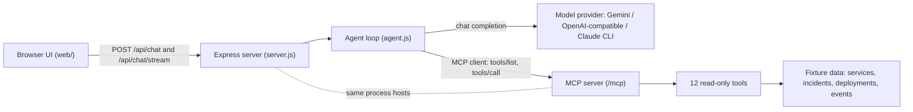

# DupTrace

**Trace the signal. Find the cause.**

**Live demo:** https://duptrace.vercel.app

DupTrace is an evidence-first incident-investigation assistant. It runs a multi-step, agentic workflow over [Model Context Protocol (MCP)](https://modelcontextprotocol.io) tools to inspect service health, incidents, deployments, and operational events, then reasons over what it gathered — while keeping the underlying evidence inspectable and keeping correlation clearly separate from proven causation.

> The incident data in this repository is **demonstrative fixture data**, not a live production monitoring integration.

## Overview

Operational investigations usually mean stitching together signals scattered across service dashboards, incident timelines, deployment history, and event logs. DupTrace turns that into a conversational workflow:

- You ask a question (for example, *"What's wrong with payments?"*).
- A server-side agent plans and calls read-only MCP tools to gather evidence — service health, active incidents, recent deployments, service events, and correlations.
- The agent returns a reasoned answer, and the UI shows the **tool activity and evidence** behind it so conclusions stay traceable.

A deliberate guardrail runs throughout: **a temporal correlation between a deployment and an incident is not treated as proof of causation.** The agent is instructed to distinguish observed evidence from unconfirmed hypotheses, and the UI preserves that distinction.

## Features

- **Multi-step incident investigations** — a bounded model/tool loop (`MAX_AGENT_STEPS`, default 12) gathers evidence across several tools before answering.
- **MCP-based tool access** — the agent discovers and calls 12 read-only investigation tools over MCP.
- **Evidence and timeline inspection** — tool results, structured facts, and incident timelines are rendered for review, with a startup integrity check that validates timeline timestamps against referenced events.
- **Follow-up questions with retained context** — context (active incident / service) is derived from *verified* tool activity, re-validated server-side against the fixtures, and carried into the next turn as labelled context (never as evidence).
- **Streaming responses with visible tool activity** — `POST /api/chat/stream` emits Server-Sent Events so tool checks appear as they happen, with a non-streaming `POST /api/chat` fallback.
- **Markdown rendering in answers** — assistant responses render headings, lists, tables, code, and links. Model output is treated as untrusted: it is parsed into a safe AST and built with `textContent` only (no raw HTML), and link schemes are allowlisted.
- **Sanitized error handling** — provider/transport failures surface as stable codes without leaking internal details or credentials.

## Architecture

A single Node.js process hosts both the web application and the MCP server:

- **Web interface** (`web/`) — plain HTML, CSS, and browser JavaScript (no build step). The browser talks only to the app's HTTP API, never to MCP directly.
- **Application / API** (`server.js`) — an Express app that serves the static UI and the chat endpoints, and mounts the MCP server at `/mcp`.
- **Agent + model provider** (`agent.js`) — the server-side agent loop. It acts as an **MCP client**, connecting to `DUPTRACE_MCP_URL` (the same process's `/mcp` over loopback), discovering the tools, and running the model↔tool loop. The model provider is pluggable: Gemini, an OpenAI-compatible API, or a local Claude CLI.
- **MCP server + fixtures** (`server.js`) — registers the read-only tools backed by in-repo fixture data.



**HTTP routes** (from `server.js`):

| Route | Method | Purpose |
|---|---|---|
| `/` and static assets | GET | Serves the web UI from `web/` |
| `/api/chat` | POST | Runs one investigation turn, returns JSON |
| `/api/chat/stream` | POST | Same contract, streamed as Server-Sent Events |
| `/mcp` | GET/POST/… | MCP endpoint (used by the server-side agent) |

**MCP tools** (all read-only): `get_service_health`, `list_active_incidents`, `get_incident`, `list_recent_deployments`, `get_deployment`, `list_service_events`, `get_event`, `get_incident_evidence`, `correlate_incident`, `get_investigation`, `summarize_investigation`, `investigate_incident`.

For local development, the server binds to loopback (`127.0.0.1`). On Vercel, the web app and chat API are publicly reachable for the hackathon demo, while the `/mcp` endpoint requires a server-only internal token. The hosted chat endpoints do not require a user session or provide per-user rate limiting, so treat this as a public demo using fixture data, not a production service.

## Requirements

- **Node.js 18 or newer.** The server and agent use the built-in global `fetch` and `AbortController`, and Express 5 requires Node 18+. Developed and tested on Node.js 22. (`package.json` does not pin an `engines` range.)
- **npm** (a `package-lock.json` is committed; `npm ci` gives a reproducible install).
- **A model provider:**
  - **Gemini (default):** your own Google AI Studio API key in `MODEL_API_KEY`.
  - **OpenAI-compatible:** an API key, model id, and base URL.
  - **Claude CLI:** a locally installed, authenticated `claude` CLI (no API key).

No external database or extra services are required — the MCP server and fixtures run inside the same process.

## Installation and setup

1. **Clone and install**

   ```bash
   git clone <your-fork-url> DupTrace
   cd DupTrace
   npm install
   ```

2. **Create your environment file**

   ```powershell
   # Windows PowerShell
   Copy-Item .env.example .env
   ```

   ```bash
   # macOS / Linux
   cp .env.example .env
   ```

3. **Set your model credentials.** For the default Gemini provider, open `.env` in an editor and set your key:

   ```dotenv
   MODEL_API_KEY=your-gemini-api-key
   ```

   Edit the file directly — do not paste the key into a shell command, and never commit `.env`. (To use a different provider, change `MODEL_PROVIDER` and the related variables; see [Configuration reference](#configuration-reference).)

4. **Start the app**

   ```bash
   npm start
   ```

   The server prints:

   ```
   MCP server listening on http://127.0.0.1:3000/mcp
   ```

   Then open the web UI at **http://127.0.0.1:3000/**. For development with automatic restarts, use `npm run dev`.

The MCP server runs in-process, so there is no separate MCP service to launch and no external fixture setup.

## Configuration reference

Primary variables (see `.env.example`):

| Variable | Purpose | Default |
|---|---|---|
| `DUPTRACE_MCP_URL` | MCP endpoint the server-side agent connects to (the app's own `/mcp`). | `http://127.0.0.1:3000/mcp` |
| `MODEL_PROVIDER` | `gemini`, `openai-compatible`, or `claude-cli`. | *(required)* |
| `MODEL_NAME` | Primary model id. For gemini, defaults to `gemini-3.5-flash-lite` when empty. | `gemini-3.1-flash-lite` (example) |
| `MODEL_API_KEY` | Provider API key. Gemini → `x-goog-api-key`; openai-compatible → `Authorization: Bearer`. Unused by `claude-cli`. | *(empty)* |
| `MODEL_FALLBACK_MODELS` | **Gemini only.** Comma-separated models tried in order on a transient failure. | `gemini-3.1-flash-lite` when unset; `.env.example` sets `gemini-3.5-flash-lite` |
| `MODEL_BASE_URL` | **OpenAI-compatible only.** API base URL (gemini uses Google's fixed endpoint). | `https://api.openai.com/v1` |
| `MODEL_CLI_COMMAND` | **Claude CLI only.** Executable to invoke. | `claude` |
| `MAX_AGENT_STEPS` | Max model/tool loop iterations per investigation. | `12` |
| `MCP_CLIENT_TIMEOUT_MS` | MCP client call timeout (ms). | `10000` |
| `MODEL_TIMEOUT_MS` | Per-request budget for gemini / openai-compatible (ms). | `60000` |
| `MODEL_CLI_TIMEOUT_MS` | Per-turn budget for the Claude CLI (ms). | `180000` |

**Provider selection.** `.env.example` ships with `MODEL_PROVIDER=gemini`, so copying it to `.env` (and setting your key) uses Gemini. `MODEL_PROVIDER` is **required and has no implicit default**: if it is absent or empty — for example, if you never create `.env` — the agent does not silently fall back to a provider. `env.js` sets no default, and `agent.js` raises `MODEL_PROVIDER_UNAVAILABLE` (surfaced by `/api/chat` as HTTP `503`) for every investigation request until a provider is configured. The empty-`MODEL_NAME` default (`gemini-3.5-flash-lite`) applies only *after* `MODEL_PROVIDER=gemini` has been selected.

**Primary and fallback behavior (Gemini):** requests use `MODEL_NAME` first. If it fails *transiently* — model unavailable, rate-limited (429), 5xx, network error, or timeout — the agent tries each model in `MODEL_FALLBACK_MODELS` in order. *Permanent* failures (invalid key / 401 / 403, or a malformed request / 400) are **not** retried, so a configuration problem is surfaced rather than masked. Each attempt is bounded by `MODEL_TIMEOUT_MS`.

**Advanced server/binding variables** (read in `server.js`, optional): `PORT` (default `3000`), `MCP_BIND_HOST` (default `127.0.0.1`), `MCP_AUTH_MODE` (`none` by default; `oauth` is intentionally not configured), `MCP_PUBLIC_URL`, `MCP_ALLOWED_HOSTS`, and `MCP_ALLOWED_ORIGINS` (host/origin allowlists; default to localhost).

Never place real secrets in `.env.example`, source, or commits.

## Usage

1. Start the app and open http://127.0.0.1:3000/.
2. Ask an investigation question. The included fixtures model four services — `payments` (degraded), `auth`, `checkout`, and `notifications` — plus incidents (`INC-2026-001`, `INC-2026-002`), deployments (`DEP-2026-0138` … `DEP-2026-0142`), and events (`EVT-2026-09xx`).

Example first question:

```
What's wrong with payments?
```

The agent checks service health, looks for active incidents, and reviews recent deployments and events, showing each tool call and its result. You can then ask follow-ups that reuse the resolved context, for example:

```
What deployment is related?
Show the evidence
What happened before the incident?
```

Expand the tool-activity entries to inspect the raw evidence behind the answer. Because the data is fixture-based and deterministic, the same questions produce the same, reviewable results — useful for a demo.

## Testing

Run the full verification suite:

```bash
npm test
```

The suite is self-contained — it uses in-process fixtures and **mocked** model providers, so it makes no real API calls and needs no API key. It runs, in order:

| Script | Covers |
|---|---|
| `_verify_integrity.mjs` | Incident-timeline integrity and follow-up context validation against the fixtures. |
| `_verify_env.mjs` | The `.env` loader (`env.js`): file parsing, real-env precedence, missing-file no-op. |
| `_verify_format.mjs` | Pure evidence formatters (labels, previews, facts, causality caveat). |
| `_verify_markdown.mjs` | The Markdown parser: tables, unsafe HTML/link handling, and partial/streaming safety. |
| `_verify_provider.mjs` | Model-provider translation/parsing with mocked fetch — including OpenAI-compatible timeout cleanup, Gemini request/response shaping, `thought_signature` preservation, and the fallback chain. |
| `_verify_web.mjs` | The real server end-to-end with a mocked provider: static assets, `/api/chat`, streaming, request validation, origin guard, follow-up context, MCP initialization, and a secret-leak scan of responses. |

You can also run a one-shot agent request from the CLI (this one **does** use the configured provider and requires a valid key/config):

```bash
npm run agent -- "What's wrong with payments?"
```

## Security and limitations

- **Do not commit `.env` or API keys.** `.env` is gitignored; keys belong only in your local `.env`.
- **Fixture data is demonstrative.** The services, incidents, deployments, and events are static sample data for demonstration — not live telemetry, and not a substitute for production observability or incident response.
- **Hosted demo security.** The Vercel demo intentionally has no login screen: `/api/chat` and `/api/chat/stream` are publicly reachable and do not require a user session. The `/mcp` route is restricted with the server-only `DUPTRACE_INTERNAL_MCP_TOKEN`. Configure `DUPTRACE_INTERNAL_MCP_TOKEN`, `MODEL_API_KEY`, and `MODEL_PROVIDER=gemini` in Vercel Project Settings; never put secrets in frontend code or commit them. Because the chat API has no per-user authentication or rate limiting, keep the hosted demo limited to its included fixture data and monitor provider usage. This is a hackathon demo, not a production deployment.
- **Read-only tools.** All MCP tools only read fixture data; there are no remediation or write actions.
- **No production-readiness claim.** This is a hackathon demonstration. It has not undergone any formal security review or certification.

## Hackathon context

DupTrace was built for the **Amazon Developer Hackathon (Alexa+)** to demonstrate an **MCP-based, multi-step agentic workflow**: an agent that discovers tools over MCP, gathers evidence across several read-only tools, and produces an evidence-backed answer with the tool activity kept inspectable.

To be clear about scope: the project implements its own MCP server and a pluggable model provider. It does **not** integrate the Alexa+ runtime or any gated Amazon tools/SDKs, and this README makes no claim of judging results, endorsements, or awards.

## License

Licensed under the **ISC License**, consistent with `"license": "ISC"` in `package.json`. See the [`LICENSE`](./LICENSE) file in the repository root for the full text.
